# Taka Counter

A calm, premium cash-counting app for Bangladeshi taka. Keep a local khata of
money in and out, and open the counting mat when you want to tally notes and
coins by hand — no account, no ads, no cloud.

## Features

- **Cash counter** — the khata: add counted cash, credits, and debits with
  `amount × notes`. Type the amount and the number of notes (or still nudge them
  with + / −), edit entries inline, swipe to delete with undo, and share a
  count. An "Open note counter" shortcut jumps straight into the counting mat.
- **Note counter** — a full-screen dark counting mat with Bangladesh Bank notes
  from ৳1 to ৳1,000 plus ৳1, ৳2, and ৳5 coins. Tap to add one, hold to add ten,
  or type a quantity for any denomination, and the tray total goes into the
  active count as one main amount. The note-and-coin breakdown is saved with
  that entry: reopen the count to see exactly how many of each note and coin
  went in, change one row, or use "Edit all" to retype the whole tray.
- **Vouchers** — turn any count into an A5 cash-count voucher with a voucher
  number, entry table, total in words, and signature lines. Share it as a PDF.
- **Excel, backup & import** — export every count as a two-sheet `.xlsx`
  (including a breakdown column), save a JSON backup, and import Excel, CSV, or
  a backup file. Exported files can be saved to Google Drive from the Android
  share sheet.
- **History** — every count saved on-device, searchable by name, note, or amount,
  with a full breakdown and share/delete actions.
- **Themes** — warm cream light mode and a deep forest dark mode, both with the
  same lite-green accent.
- **Bengali details** — Bengali numerals on note artwork, Bengali note names, and
  Indian lakh/crore grouping (`৳1,93,130`).
- **Private by default** — data stays in local storage on the device.

## Screenshots

| Light | Dark |
| --- | --- |
| 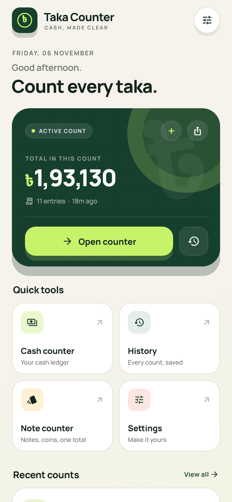 | 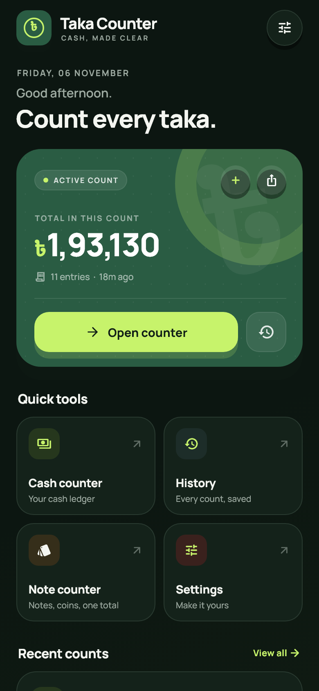 |
| 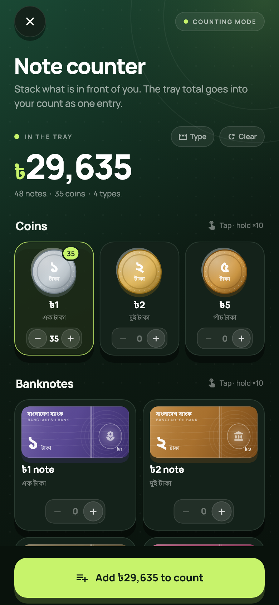 | 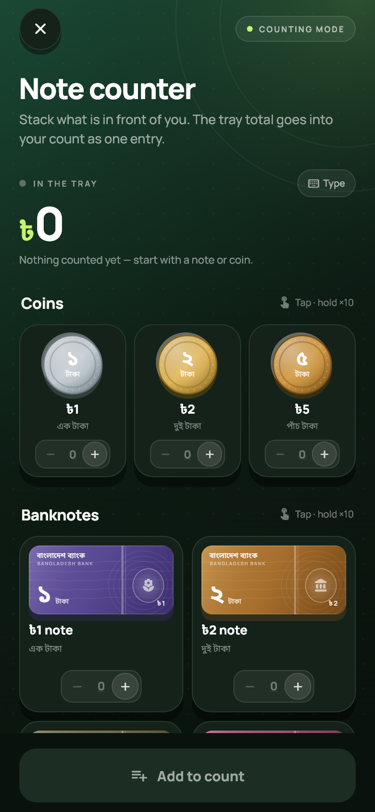 |
| 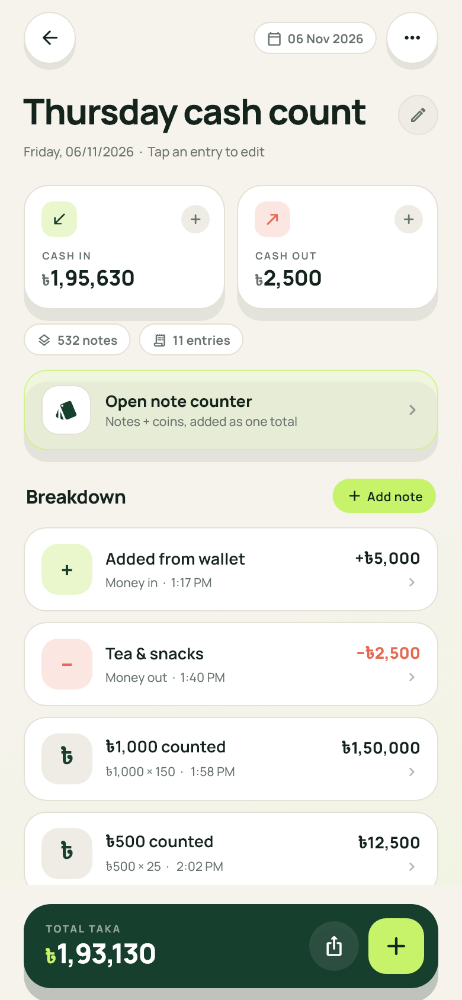 | 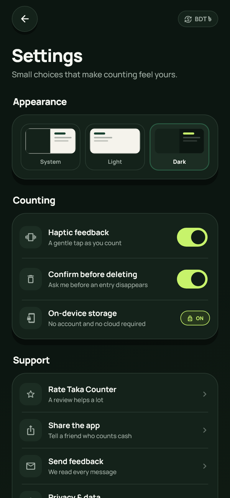 |
| 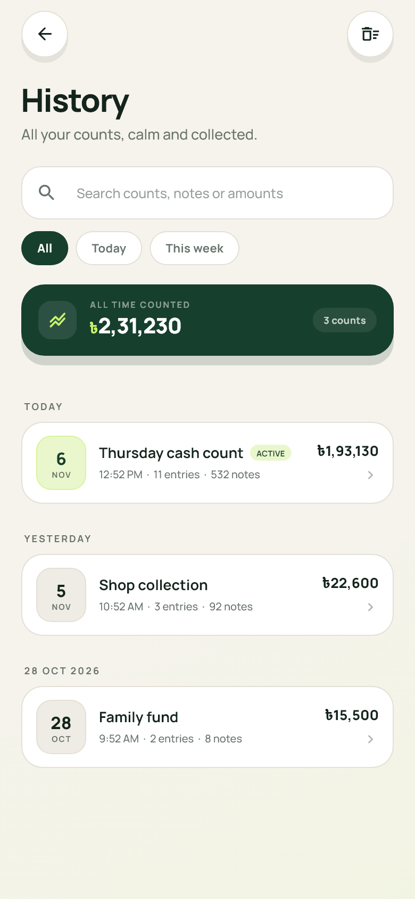 | 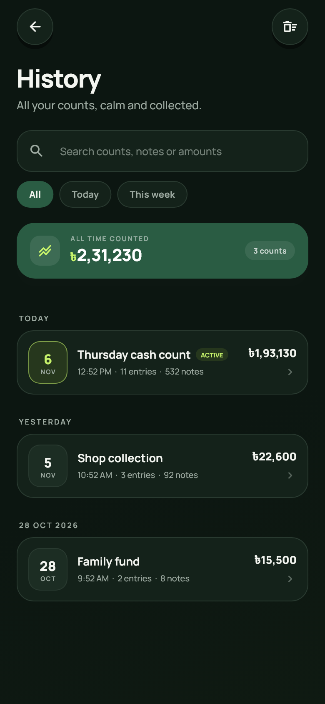 |
| 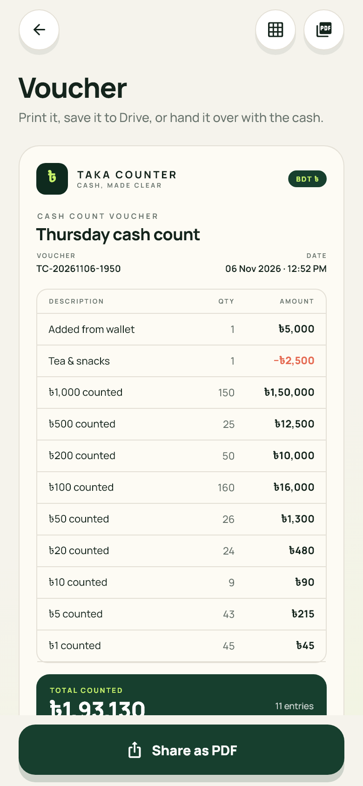 | 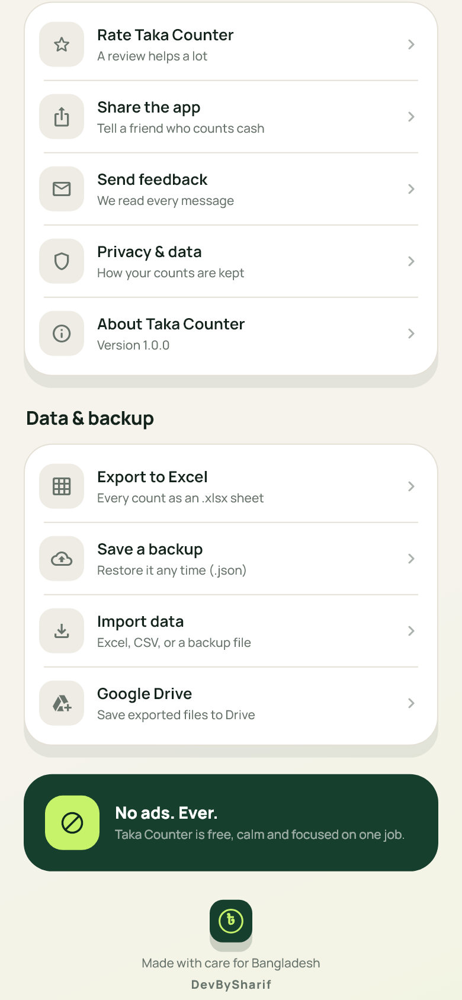 |

More captures live in [`screenshots/`](screenshots). The note counter keeps its
own dark counting-mat look in both themes so it reads as a counting tool, not a
second ledger.

A tray count is saved with its full note-and-coin breakdown, and reopening it
from the ledger brings every denomination back for editing:

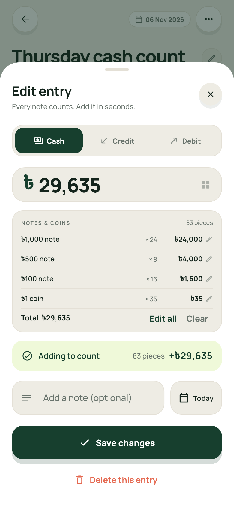

## Run it

```bash
flutter pub get
flutter run
```

Build a release APK:

```bash
flutter build apk --release
```

Build the Play Store bundle (upload this, not the APK):

```bash
flutter build appbundle --release
# build/app/outputs/bundle/release/app-release.aab
```

Release builds are signed with the upload key in
`android/app/upload-keystore.jks`; credentials live in `android/key.properties`.
Both are gitignored. See [`store/KEYSTORE.md`](store/KEYSTORE.md) before the
first upload, and back both files up.

A web preview with sample data is available while developing:

```bash
flutter run -d web-server --web-port=8091 --web-hostname=127.0.0.1
# then open http://127.0.0.1:8091/preview.html
```

The preview page frames the app at a 390 × 844 phone size and loads it with
`?demo=1`; a normal install always starts with a clean count.

## Stack

- Flutter 3.32 / Dart 3.8, Android + web
- `shared_preferences` for local persistence
- `share_plus` for sharing a count and exported files
- `excel` for `.xlsx` export/import, `pdf` for vouchers
- `file_picker` for importing a backup or sheet
- `intl` for dates
- Bundled Manrope + Noto Sans Bengali fonts and hand-drawn note and coin
  artwork (no licensed currency scans are shipped)

## Verification

```bash
flutter analyze
flutter test
```

The test suite covers money formatting, the home screen, the note-counter tray
flow (tapping and typing), typed note quantities in the cash counter, Excel/CSV/JSON
import-export, voucher PDFs, small-screen robustness, and a screenshot harness
that renders every screen in light and dark mode into `screenshots/`.

Regenerate the Play Store artwork after UI changes:

```bash
flutter test test/screenshots_test.dart
python tool/make_store_assets.py
```

## Play Store

- Package: `com.devbysharif.takacounter`
- Version: `1.0.0+1`, target SDK 36
- Category: Finance · no ads · no account · fully offline
- Store copy: [`store/LISTING.md`](store/LISTING.md)
- Privacy policy: [`store/PRIVACY_POLICY.md`](store/PRIVACY_POLICY.md) and
  [`store/privacy-policy.html`](store/privacy-policy.html)
- Data safety: [`store/DATA_SAFETY.md`](store/DATA_SAFETY.md)
- Content rating: [`store/CONTENT_RATING.md`](store/CONTENT_RATING.md)
- Assets manifest: [`store/ASSETS.md`](store/ASSETS.md)
- Keystore and Play App Signing: [`store/KEYSTORE.md`](store/KEYSTORE.md)
- Step-by-step release: [`store/RELEASE_CHECKLIST.md`](store/RELEASE_CHECKLIST.md)
- Current build hashes and verification: [`store/BUILD_REPORT.md`](store/BUILD_REPORT.md)

## Credits

Built by **DevBySharif** — shown in the app footer, the settings footer, the
About sheet, and shared count text.
